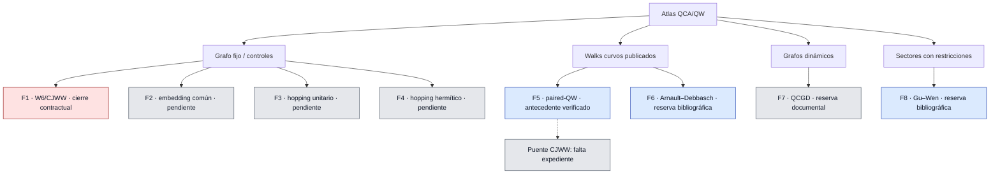

# Atlas de familias geométricas para QCA/QW

Primera edición documental: 2026-09-30. Base inspeccionada:
`research/gravitational-normalization-gate` @ `16850476a6320c55aaf6d25471d00454cdc15b41`.

El atlas registra clases, contratos, obstrucciones y puentes. No decide gates:
manda [CURRENT_STATE](../../state/CURRENT_STATE.md). No es una clasificación
exhaustiva, una afirmación de novedad ni una autorización para abrir modelos.
Los IDs F son del atlas; no sustituyen los IDs W del proyecto.

## Registro maestro

| ID / ficha | Clase y objeto geométrico | Resultado trazable en esta edición | Evidencia / decisión |
|---|---|---|---|
| [F1 — W6 Pauli-selective](families/F1_w6_pauli_selective.md) | Grafo fijo; nueve controles de transporte; métrica del símbolo principal | `UNIVERSAL_SUBFAMILY_DEFICIENT`: rango 3/6 sobre métricas constantes | Revisión W12 registrada; `CLOSED_BY_CONTRACT` para W6/CJWW |
| [F2 — Embedding común](families/F2_common_embedding.md) | Propuesta de embedding afín común; regla pendiente de localizar | `[UNVERIFIED]`: universalidad/rango 6 mencionados en la propuesta | Pendiente de trazabilidad; sin decisión incorporada |
| [F3 — Hopping unitario elástico](families/F3_unitary_elastic.md) | Propuesta de hopping con orientación de semisoporte | `[UNVERIFIED]`: inconsistencia de orientación mencionada en la propuesta | Pendiente de contrato y contraejemplo |
| [F4 — Hopping hermítico elástico](families/F4_hermitian_elastic.md) | Propuesta de respuesta hermítica; embedding y hopping por separar | `[UNVERIFIED]`: contribución métrica nula del hopping mencionada en la propuesta | Pendiente de regla y certificado |
| [F5 — Puente paired-QW](families/F5_arrighi_facchini_bridge.md) | Antecedente publicado de QWs curvos mediante agrupación y codificación | Antecedente comprobado; bloqueo exacto con CJWW `[UNVERIFIED]` | Bibliográfico; falta expediente del puente |

F2–F5 preservan los nombres y las afirmaciones recibidas, no las certifican.
La búsqueda en los documentos y scripts del checkout no localizó sus expedientes.
La ausencia local no implica que no existan en otra rama o carpeta. Véase
[provenance y comprobaciones](PROVENANCE.md).

## Mapa de navegación

Las aristas clasifican entradas; no representan implicaciones ni equivalencias.
El color expresa el estado documental de esta edición, no viabilidad física.
Rojo: cierre contractual; gris: trazabilidad pendiente; azul: antecedente
bibliográfico; amarillo: cuestión abierta; verde: test acotado superado
(ninguna familia completa recibe verde en esta edición).

## Entradas reservadas fuera del núcleo

| ID | Identidad y evidencia de entrada | Límite de esta edición |
|---|---|---|
| F6 | Arnault–Debbasch, `biblioteca/arXiv-1609.00722.pdf` p.1: DTQWs en (1+2)D con límite de Dirac en campo gravitatorio | Fuente leída en p.1; no se evalúan aquí universalidad entre especies ni backreaction |
| F7 | QCGD / grafo dinámico; [registro local de selección](../../reports/2026-09-29--dynamical-geometry-model-class.md), [no-go del puente fuerte](../../reports/2026-09-29--explicit-cjww-dynamic-graph-bridge.md) | Referencias de navegación; sin nueva verificación de la clase ni de su no-go en esta edición |
| F8 | Gu–Wen, `biblioteca/arXiv-0907.1203.pdf` p.1: separar modelo L (dispersión cúbica, análisis semiclásico) y modelo N (dispersión lineal argumentada sin control fiable) | No fusionar ambos modelos ni atribuir a L dinámica de Einstein; dossier completo pendiente |

Pretko queda como referencia candidata para una entrada distinta, sin asignar
resultado ni identificarlo con Gu–Wen. La secuencia W1–W11 puede incorporarse
mediante nuevas fichas o antecedentes de F1; este núcleo no la inventaría por completo.

## Reglas de incorporación

1. Registrar también las familias descartadas. Un resultado breve merece
   entrada si su clase y evidencia pueden identificarse.
2. Usar la [plantilla](FAMILY_TEMPLATE.md). Conservar por separado resultado
   matemático, nivel de evidencia, revisión y decisión canónica.
3. Congelar clase, soporte, especies, coordenadas, equivalencias y test antes
   de calcular. Si faltan, escribir «no localizado»; el atlas no los reconstruye.
4. Vincular contrato, código permanente, informe, revisión y commits. Para
   bibliografía, citar PDF y página leída. Texto generado no sustituye evidencia.
5. Un cambio de cuantificadores o de regla requiere expediente propio y relación
   explícita con su antecedente. No borrar el fallo ni rescatarlo a posteriori.
6. Mantener el mismo flujo visual por ficha: control → símbolo → términos
   no métricos → marco → métrica → test. Usar pasos pendientes cuando falte evidencia.
7. Los diagramas Mermaid son fuente editable permanente dentro de las fichas.
   Si se exportan figuras, conservar el generador y su correspondencia con la ficha.

## Distinciones de lectura

El atlas separa embedding, métrica efectiva, soporte causal, transporte,
gauge y restricciones. Una rotación de marco que deja una métrica invariante
no acredita por sí sola una simetría gauge microscópica. Tampoco un coin,
un desplazamiento nodal, una fase escalar o una conexión de espín cuentan
automáticamente como deformación métrica: cada familia debe declarar el test
que los separa. No se impone una taxonomía universal antes de definir el modelo.
