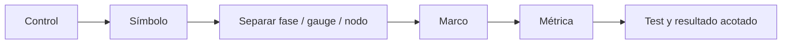

# F<n> — <nombre>

[Volver al atlas](FAMILY_BIBLE.md). Al copiar a `families/`, ajustar este enlace.

## 1. Identidad

- ID estable, nombre, fecha de apertura del modelo y fecha de alta en el atlas.
- Motivación independiente documentada antes del cálculo.
- Problema, fuente primaria y relación con familias anteriores.

## 2. Cuantificadores congelados

| Campo | Valor / fuente |
|---|---|
| Dimensión espacial e interna; Hilbert | Pendiente |
| Walk/QCA base; regla; soporte/grupo/lattice | Pendiente |
| Especies, nodos y sectores incluidos/excluidos | Pendiente |
| Coordenadas, unidades y equivalencias permitidas | Pendiente |
| Controles; fondos constantes o variables | Pendiente |
| Grouping, supercell y ancillas | Pendiente |
| Orden perturbativo y tipo de exactitud | Pendiente |
| Observable geométrico; tolerancia y umbral PASS/FAIL | Pendiente |

## 3. Qué es geometría

Definición operacional y objeto matemático, con convención de índices.

## 4. Qué no se cuenta como geometría

Separación comprobable de gauge, rotación de marco, coin, conexión,
desplazamiento nodal, potencial y fase. No declarar equivalencias no probadas.

## 5. Regla microscópica

Fórmula y enlace a implementación permanente. Distinguir regla exacta de
expansión. Si falta, detener la ficha científica en «pendiente de trazabilidad».

## 6. Kill tests

Obligaciones congeladas y sus umbrales: universalidad, rango, factorización,
orientación, límite plano, localidad/unitariedad y separación geometría/gauge,
solo según sean aplicables. No añadir tests retrospectivos al contrato original.

## 7. Resultado

- Resultado: PASS / FAIL / OPEN / BLOCKED / INCONSISTENT, o literal contractual.
- Evidencia: ESTABLISHED / SUPPORTED / PRELIMINARY / OPEN / REJECTED;
  usar `[UNVERIFIED]` si no se ha comprobado.
- Revisión: autores, fecha, objeto exacto y reparaciones pendientes.
- Decisión canónica: separada del resultado y enlazada al estado del proyecto.
- Contrato / código / informe / revisión / commits / páginas primarias.

## 8. Modo de fallo

Obstrucción y cuantificadores a los que se aplica. Si no hubo test, no inventar
un fallo. Si solo existe un relato, atribuirlo y marcarlo `[UNVERIFIED]`.

## 9. Qué deja vivo

Resultado reutilizable y límites. Próximo movimiento admisible documental o
matemático; su admisibilidad no equivale a autorización.

## 10. Qué queda prohibido después

Rescates, ajustes y cambios de especie, soporte o celda excluidos por el contrato.

## Flujo visual

