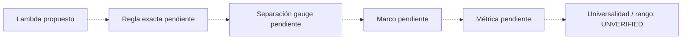

# F2 — Embedding afín común

[Atlas](../FAMILY_BIBLE.md)

## 1. Identidad

Entrada recibida en la propuesta del usuario; alta documental 2026-09-30.
Fecha de apertura científica y motivación independiente previa: no localizadas.
Objeto propuesto: deformar un embedding común para las especies.

## 2. Cuantificadores congelados

No se ha localizado contrato. Dimensión interna, walk exacto, especies,
lattice, soporte, grouping/supercell/ancillas, escalas, orden y equivalencias:
pendientes. «Común» es parte del nombre propuesto, no prueba de que los
cuantificadores estuvieran congelados. No se heredan automáticamente los de F1.

## 3. Qué es geometría

La propuesta habla de un embedding afín `Λ` y una métrica común. Su
definición operacional y su relación con las coordenadas físicas no están
documentadas en una fuente localizada.

## 4. Qué no se cuenta como geometría

Pendiente de precisar embedding cinemático frente a respuesta de hopping,
gauge y dinámica. No atribuir dinámica a una transformación de coordenadas.

## 5. Regla microscópica

No localizada. La propuesta da el esquema `p → Λᵀp`; no se adopta aquí como
regla completa ni como conservación probada de soporte o unitariedad.

## 6. Kill tests

La propuesta menciona universalidad y rango 6/6. Falta el contrato que fije
especies, espacio de controles, convención métrica y umbral. No se ejecutan.

## 7. Resultado

**Pendiente de trazabilidad, `[UNVERIFIED]`.** Literal recibido:
`KINEMATIC_COMMON_EMBEDDING_UNIVERSAL / ELASTIC_HOPPING_RESPONSE_OPEN`.
No se ha localizado informe, certificado, revisión ni commit que permita
incorporarlo como resultado verificado o decisión canónica.

## 8. Modo de fallo

No determinado. La limitación «solo cinemática» procede de la propuesta y
queda `[UNVERIFIED]` hasta leer la definición y la derivación originales.

## 9. Qué deja vivo

Una entrada identificable para recuperar el expediente, sin perder la
distinción entre embedding y hopping. Próximo movimiento: localizar fuentes.

## 10. Qué queda prohibido después

No usar esta ficha como justificación física previa, como PASS ni como
reapertura de F1. No reconstruir un contrato retrospectivo para el rango citado.

## Flujo visual

