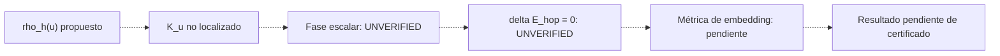

# F4 — Respuesta de hopping elástico hermítico

[Atlas](../FAMILY_BIBLE.md)

## 1. Identidad

Nombre y relación de sucesión con F3 recibidos en la propuesta del usuario.
Alta documental: 2026-09-30. Fecha de apertura científica y justificación
independiente anterior al cálculo: no localizadas.

## 2. Cuantificadores congelados

No hay contrato localizado. Pendientes: espacio interno, materia, especies,
soporte, controles elásticos, orientación, coordenadas, agrupaciones,
supercell/ancillas, orden y definición métrica. No importar los de F2/F3.

## 3. Qué es geometría

La propuesta distingue una métrica de embedding y una posible respuesta
adicional del hopping. La descomposición exacta está pendiente de fuente.

## 4. Qué no se cuenta como geometría

Una fase escalar no se contará como cambio de marco sin comprobar su
dependencia en momento y la extracción del símbolo. La afirmación de que
solo queda esa fase procede de la propuesta, no de un cálculo en esta edición.

## 5. Regla microscópica

El esquema recibido nombra `ρ_h(u)` y `K_u`; no se han localizado sus
definiciones. Hermiticidad de un generador no basta para fijar por sí sola
una actualización discreta de alcance finito: falta la regla concreta.

## 6. Kill tests

Orientación, universalidad y contribución métrica del hopping mencionados
en la propuesta. Contrato, órdenes retenidos y criterios PASS/FAIL pendientes.

## 7. Resultado

**Pendiente de trazabilidad, `[UNVERIFIED]`.** Literal recibido:
`HERMITIAN_ELASTIC_METRIC_UNIVERSAL_EMBEDDING_ONLY`.
La afirmación `δE_hop=0` necesita definición y certificado. No hay informe,
revisión ni commit localizado que permita adoptarla como resultado.

## 8. Modo de fallo

Contribución métrica nueva nula, según la propuesta. No implica hopping
nulo, ausencia de otros efectos ni un no-go para toda regla hermítica.

## 9. Qué deja vivo

Una comparación propuesta entre embedding y hopping. Próximo movimiento:
recuperar la regla y el cálculo que separa ambas contribuciones.

## 10. Qué queda prohibido después

No presentar la reparación de orientación ni la universalidad como PASS.
No cambiar órdenes, controles o especies para evitar una cancelación bajo
el mismo contrato; cualquier sucesor necesita su expediente previo.

## Flujo visual

