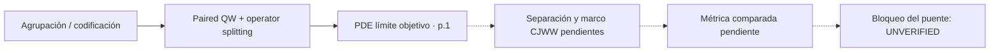

# F5 — Puente al esquema paired-QW de Arrighi–Facchini

[Atlas](../FAMILY_BIBLE.md)

## 1. Identidad

Dos objetos separados: una familia publicada y un supuesto test de puente
exacto a CJWW (5.15). Alta en el atlas: 2026-09-30. Fecha de apertura y
motivación contractual del puente: no localizadas.

Fuente leída: `biblioteca/1609.00305v2.pdf` p.1, Arrighi y Facchini,
*Quantum walking in curved spacetime: (3 + 1) dimensions, and beyond*.
En esa página se describen agrupación/codificación, paired QWs y combinación
por operator splitting para obtener límites continuos, incluido Dirac curvo.
No confundir con `biblioteca/arXiv-1505.07023.pdf` p.1, Arrighi, Facchini y
Forets, cuyo resultado allí descrito es en (1+1)D.

## 2. Cuantificadores congelados

La publicación 1609.00305 p.1 anuncia dimensiones espaciales arbitrarias y
dimensión interna par, con agrupación y codificación. No determina por ello
los cuantificadores de un puente a CJWW de celda original de dos componentes.

Contrato del puente no localizado: quedan pendientes soporte, sectores,
especies, coordenadas, pasos temporales, grouping/supercell/ancillas,
equivalencias y si se compara el operador completo o solo su límite continuo.

## 3. Qué es geometría

En el antecedente, un campo métrico se representa mediante unitarias locales
cuyo límite continuo reproduce la ecuación objetivo (1609.00305, p.1).
Esta atribución no establece equivalencia exacta con CJWW.

## 4. Qué no se cuenta como geometría

Coincidencia de PDE límite y equivalencia microscópica son criterios distintos.
Una construcción de Dirac curvo no prueba por sí sola dinámica autónoma del
campo geométrico ni backreaction en el modelo que aquí se busca catalogar.

## 5. Regla microscópica

La regla de un puente exacto a CJWW no se ha localizado. Se remite al paper
para la familia publicada; esta ficha no transcribe ni audita su construcción
completa a partir de la primera página.

## 6. Kill tests

La propuesta menciona obstrucción en el operator split estándar y exactitud
plana respecto de CJWW (5.15). Faltan el contrato y la prueba del bloqueo.
No extender una eventual obstrucción a esquemas agrupados diferentes.

## 7. Resultado

**Antecedente bibliográfico comprobado en p.1; puente pendiente de trazabilidad.**
Literal recibido para el puente:
`STRUCTURALLY_BLOCKED_IN_STANDARD_OPERATOR_SPLIT` — **`[UNVERIFIED]`**.
No se ha localizado un reporte, certificado, revisión o commit de ese resultado.
La verificación bibliográfica de esta ficha no verifica ese bloqueo.

## 8. Modo de fallo

Factorización/operator splitting según la propuesta; sin prueba localizada.
No se atribuye ese fallo a Arrighi–Facchini ni a todos los paired QWs.

## 9. Qué deja vivo

Un antecedente primario identificado y la distinción entre simulación de
una PDE y equivalencia exacta de walks. Próximo movimiento documental:
localizar contrato y prueba del puente, incluyendo transformaciones permitidas.

## 10. Qué queda prohibido después

No usar la publicación como prueba del bloqueo CJWW; no presentar el bloqueo
alegado como teorema general. No añadir agrupación, ancillas o cambio de paso
temporal después del test sin un contrato distinto.

## Flujo visual

