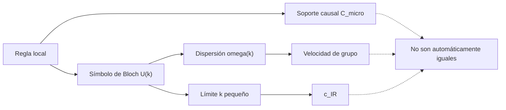

# 0. La pregunta física

Una red cuántica local tiene una limitación sencilla: en un paso solo puede
interactuar con sus vecinos. Eso dibuja un cono causal microscópico.

La pregunta del proyecto es más fina:

> Cuando una dinámica local se observa a escalas grandes, ¿la velocidad de la
> ecuación relativista que emerge está determinada por el cono causal de la red?

Hay varias velocidades que no debemos mezclar:

| Símbolo | Pregunta |
|---|---|
| `C_micro` | ¿Qué desplazamientos son posibles en un paso? |
| `V_causal^max` | ¿Cuál es el mayor soporte direccional del cono microscópico? |
| `V_grp^max` | ¿Cuál es la mayor velocidad de grupo de la dispersión? |
| `c_IR` | ¿Qué velocidad aparece en el límite relativista de baja energía? |

En una dimensión estas cantidades pueden parecerse mucho. En varias
dimensiones, `C_micro` es un cuerpo convexo y una sola cifra puede ocultar
anisotropías.

## Qué hace difícil la pregunta

Una red puede tener desplazamientos diagonales y una ecuación Weyl muy
isótropa a bajo momento, pero seguir teniendo una dispersión diferente a
momento finito. También puede haber varios nodos o especies que vean de forma
distinta una deformación.

Por eso el proyecto congela siempre: red, celda, especies, nodos, unidades,
controles, orden perturbativo y criterio PASS/FAIL.
