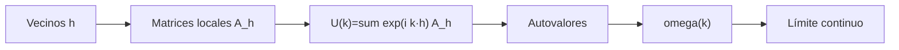

# 1. QCA, quantum walks y conos causales

## QCA en una frase

Una QCA es una evolución cuántica unitaria y local de muchos sistemas
discretos. «Unitaria» significa reversible y conservación de norma; «local»
significa que la actualización no conecta arbitrariamente dos puntos lejanos.

Un quantum walk es el sector lineal de una dinámica de este tipo para una
partícula o un campo libre. Se puede escribir esquemáticamente como

```text
psi(t+1) = sum_h A_h psi(x-h,t),
```

donde `h` recorre desplazamientos permitidos y `A_h` actúa sobre un espacio
interno, el coin.

## El coin no es automáticamente una dimensión espacial

El coin puede codificar espín, quiralidad u otros grados internos. Tener dos
componentes no significa tener dos dimensiones espaciales. La dimensión
espacial la determina el conjunto de desplazamientos y la estructura del
grupo o red.

## De la regla al símbolo

Si la regla es homogénea, una transformada de Fourier convierte los
desplazamientos en fases:

```text
U(k) = sum_h exp(i k·h) A_h.
```

Las propiedades locales se vuelven condiciones algebraicas sobre `U(k)`. Sus
autovalores dan fases y, tras escoger una rama, una dispersión `omega(k)`.



## Ejercicio mental

En una red 1D con dos estados internos, imagina que el estado `R` se desplaza
a la derecha y `L` a la izquierda. Sin mezcla, la partícula se separa en dos
trayectorias. Una mezcla local entre `R` y `L` puede producir una dinámica
dispersiva parecida a Dirac en el límite continuo.

La mezcla no crea por sí sola una métrica: solo cambia la regla interna. Para
llamar «geométrica» a una deformación hay que especificar qué observable cambia
y cómo se distingue de una fase, una rotación de marco o un gauge.
