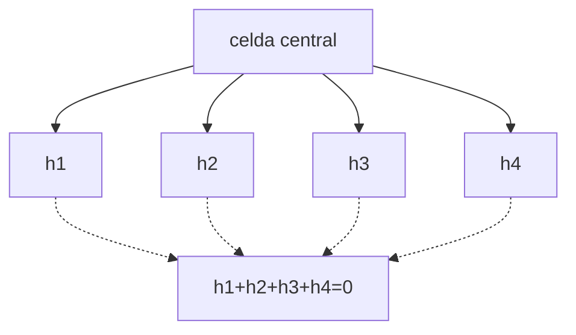

# 2. Ejemplo: Weyl en una red BCC

Este ejemplo explica por qué BCC aparece tantas veces en el atlas. No es una
nueva derivación: resume los antecedentes documentados en F12, F14, F15, F16 y
F17.

## La red

En tres dimensiones se pueden escoger cuatro desplazamientos diagonales cuya
suma es cero. Sus vecinos forman la geometría body-centred cubic (BCC).



La red no es todavía una métrica relativista. Es el soporte de una regla
microscópica.

## La regla y el límite

Una regla Weyl de dos componentes combina los cuatro desplazamientos con
matrices `A_h`. En Fourier aparece un símbolo `U(k)`. Cerca de un nodo de baja
energía, la expansión puede tener la forma

```text
U(k) = I - i (sigma_x k_x + sigma_y k_y + sigma_z k_z) + O(|k|^2).
```

El término lineal es el que recuerda al Hamiltoniano Weyl. El término
`O(|k|^2)` sigue siendo importante para la física a momento finito.

## Qué muestra y qué no muestra

Muestra:

- que una regla local puede producir una ecuación Weyl a baja energía;
- que isotropía, soporte y representación interna restringen fuertemente las
  reglas posibles;
- que la dispersión puede desviarse del comportamiento relativista fuera del
  régimen de bajo momento.

No muestra automáticamente:

- una métrica variable;
- una teoría de gravedad;
- una respuesta idéntica de cuatro especies a controles geométricos;
- una escala física absoluta igual a `c`.

Ese salto es precisamente lo que separa las familias documentales de los
gates propios del proyecto.
