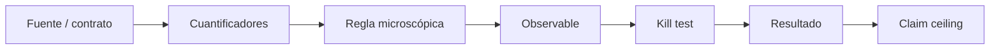

# 3. Cómo leer una familia del atlas

Cada ficha sigue el mismo recorrido. La uniformidad permite comparar modelos
que usan palabras parecidas.

## 1. Identidad

¿Qué artículo, regla o contrato estamos leyendo? ¿Es una familia propia del
proyecto, un sucesor o solo un antecedente?

## 2. Cuantificadores

Hay que localizar dimensión espacial, dimensión interna, celda, soporte,
especies, nodos, unidades y equivalencias permitidas. Un resultado para `s=2`
no se convierte sin más en un resultado para cuatro especies.

## 3. Regla microscópica

Preguntar qué evoluciona realmente:

- ¿un tick unitario?
- ¿un Hamiltoniano continuo?
- ¿un circuito de substeps?
- ¿un modelo estadístico o una teoría efectiva?

Dos artículos pueden producir una ecuación parecida con reglas microscópicas
incompatibles.

## 4. Observable geométrico

¿Qué objeto se llama geometría? Puede ser un soporte causal, un embedding, un
marco principal, una métrica, una variable gauge o una restricción. El nombre
no basta; debe haber una definición operacional.

## 5. Kill test

El kill test es la manera más rápida de averiguar qué no puede afirmarse. Por
ejemplo, F3 falla por una ambigüedad de orientación antes de ejecutar el test
de especies; F5 solo excluye una factorización restringida; F13 muestra que
rotacional no implica Lorentz.

## 6. Claim ceiling

Al final de cada ficha debe poder completarse:

> Este resultado permite afirmar ___, bajo ___; no permite afirmar ___.

