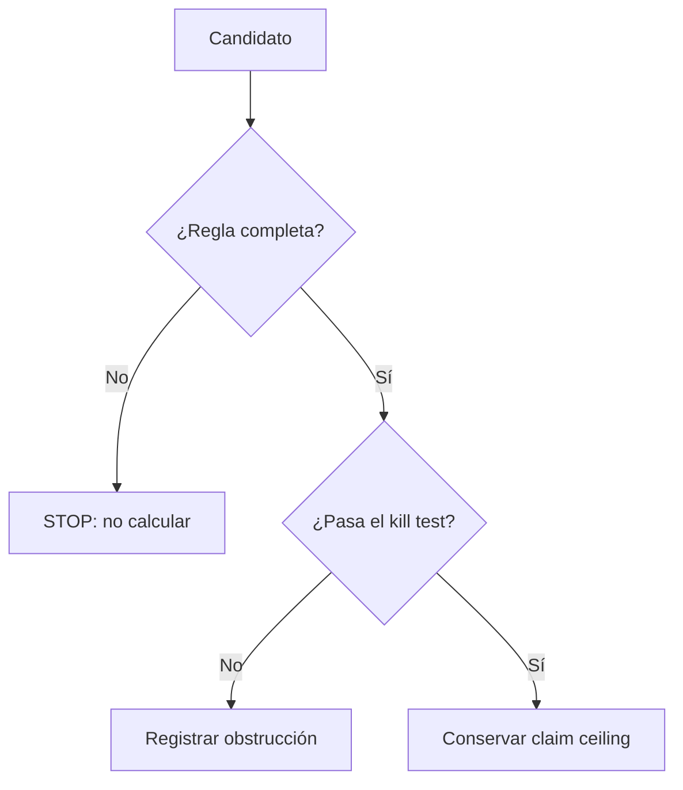

# 5. Fallos y obstrucciones

Un atlas científico no debe mostrar solo los modelos que sobreviven. Los
fallos son útiles porque dicen qué hipótesis faltaba.

## F1: rango insuficiente

En la clase W6/CJWW, W12 encuentra una subfamilia universal de dimensión 3,
pero la respuesta métrica constante tiene rango `3/6`. Es un resultado negativo
para esa clase de controles, no una afirmación de que ninguna QCA pueda tener
gravedad.

## F3: la orientación no está definida

El intento de hopping unitario depende de escoger una orientación del
semisoporte. Si dos elecciones producen generadores distintos, el modelo no
está bien definido antes del test de especies.

## F5: un no-go con cuantificadores estrechos

El certificado excluye una factorización en tres factores, un factor por
coordenada, en la celda original y un tick. Cambiar celda, agrupar pasos o
añadir ancillas sería otro problema, no una refutación del certificado.

## F7: falta la regla

Una arquitectura de grafos dinámicos puede ser interesante, pero sin una regla
`U(g)` completa y un observable geométrico no hay símbolo que calcular.

## F13: rotación no basta

Una teoría puede tener simetría rotacional y aun así no ser Lorentziana. La
dimensión del espacio interno y la forma del Hamiltoniano importan.

## Regla para recordar

Un fallo no se arregla cambiando retrospectivamente el contrato. Se registra,
se conserva su alcance y se abre otro expediente si la nueva regla está
físicamente motivada y es realmente distinta.

